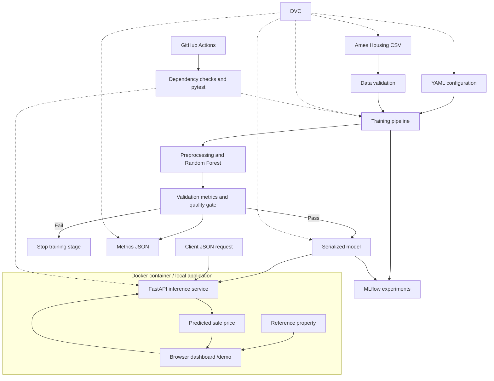

# House Price Prediction — End-to-End MLOps

[](https://github.com/BuiltbyUjjwal/house-price-mlops/actions/workflows/ci.yml)


A reproducible machine learning pipeline for predicting residential sale prices from the Ames Housing dataset. The project combines data validation, preprocessing, model training, quality gates, experiment tracking, data and model versioning, API serving, an interactive browser-based prediction dashboard, containerization, and automated testing.

## Interactive demo

Once the model and application are running, open **[House Price Studio](http://127.0.0.1:8000/demo)** in your browser. Edit eight property characteristics, select **Predict House Price**, and view the estimated sale price in US dollars. The dashboard sends a real request to the FastAPI prediction endpoint; the remaining model inputs come from a reference property. No separate frontend server is required. See the Quick start section below for setup instructions.

## Architecture



DVC manages reproducibility and artifact versions. MLflow tracks experiment runs, parameters, metrics, and model artifacts. GitHub Actions validates dependencies and executes automated tests on pushes and pull requests.

## Model performance

Reference validation run using a random 80/20 split (seed 42):

| Metric | Result | Quality gate |
| --- | ---: | ---: |
| Mean absolute error (MAE) | $17,559.78 | ≤ $30,000 |
| Root mean squared error (RMSE) | $29,031.58 | ≤ $45,000 |
| R² | 0.8901 | ≥ 0.75 |

**Quality gate: Passed.** Training samples: 1,168; validation samples: 292. These are holdout validation results, not production performance or evidence of generalization to other housing markets.

## Technology stack

| Component | Technology |
| --- | --- |
| Data processing | pandas, NumPy |
| ML pipeline | scikit-learn, Random Forest Regressor |
| Configuration | YAML |
| Model serialization | joblib, MLflow/skops |
| Experiment tracking | MLflow with local SQLite |
| Data and pipeline versioning | DVC |
| Inference service | FastAPI, Uvicorn |
| Interactive dashboard | HTML, CSS, JavaScript |
| Containerization | Docker |
| Testing and CI | pytest, GitHub Actions |

## Repository structure

```text
house-price-mlops/
├── .github/workflows/ci.yml
├── .dvc/                      # DVC configuration (cache kept locally)
├── configs/config.yaml
├── data/raw/train.csv.dvc     # Dataset metadata, not the CSV itself
├── models/                    # Local/DVC-managed model artifact
├── reports/metrics.json
├── src/house_price/
│   ├── api.py
│   ├── config.py
│   ├── data.py
│   ├── demo.html
│   ├── demo_sample.json
│   ├── evaluation.py
│   ├── preprocessing.py
│   ├── tracking.py
│   └── train.py
├── tests/
├── dvc.yaml
├── dvc.lock
├── Dockerfile
├── .dockerignore
├── pyproject.toml
└── requirements.txt
```

## Quick start

### 1. Clone and install

Use Python 3.11. Docker Desktop or Docker Engine is needed only for containerized serving.

```bash
git clone https://github.com/BuiltbyUjjwal/house-price-mlops.git
cd house-price-mlops
python -m venv .venv
```

Windows PowerShell:

```powershell
.\.venv\Scripts\Activate.ps1
```

Linux/macOS:

```bash
source .venv/bin/activate
```

Install the project and development tools:

```bash
python -m pip install -e ".[dev]"
python -m pip check
python -m pytest -v
```

### 2. Obtain the dataset

Download `train.csv` from Kaggle's [House Prices: Advanced Regression Techniques](https://www.kaggle.com/competitions/house-prices-advanced-regression-techniques/data) competition, subject to its data access terms. Place it at `data/raw/train.csv`.

The original dataset contains 1,460 records and 81 columns. The pipeline excludes `Id` and uses `SalePrice` as the target, leaving 79 prediction features.

If you have access to a configured DVC remote containing the tracked dataset and model, `dvc pull` can restore them instead. The repository alone does not provide access to a shared artifact remote.

### 3. Reproduce training

```bash
dvc repro
dvc status
dvc metrics show
```

The pipeline validates the data, applies numerical and categorical imputation, encodes categorical features, trains a Random Forest model, and evaluates the candidate against configurable thresholds. A failed quality gate prevents publishing a new accepted model. Successful execution produces `models/house_price_model.joblib` and `reports/metrics.json` and records an MLflow run.

DVC records dependencies, parameters and outputs in `dvc.lock`. Repeating `dvc repro` with unchanged inputs and available outputs should skip unchanged stages. To explicitly execute the training stage again, use `dvc repro --force train`.

### 4. Inspect MLflow experiments

Run the server from the repository root:

```bash
mlflow server --backend-store-uri sqlite:///mlflow.db --host 127.0.0.1 --port 5000
```

Open <http://127.0.0.1:5000> and select the `house-price-prediction` experiment. A model artifact is logged for successful training runs. The database and artifact storage are local to the environment in which training runs.

### 5. Serve predictions locally

After the model artifact is available:

```bash
uvicorn house_price.api:app --host 127.0.0.1 --port 8000
```

Open the interactive dashboard at <http://127.0.0.1:8000/demo>. Change the editable property features, click the prediction button, and use Reset to restore the reference values.

For direct API testing, open Swagger UI at <http://127.0.0.1:8000/docs>.

| Method | Endpoint | Purpose |
| --- | --- | --- |
| GET | `/` | Service information |
| GET | `/health` | Model readiness check |
| POST | `/predict` | Predict a house sale price |
| GET | `/demo` | Interactive house-price dashboard |
| GET | `/demo/sample` | Reference property features for the dashboard |

The prediction endpoint expects a JSON object with a `features` field containing all 79 original feature names. Missing values can be represented by JSON `null`; absent or unexpected feature names are rejected.

With the API running, use a second terminal with the virtual environment active. This Python command generates a real request from the first dataset row and sends it to the service:

```bash
python -c "import json, urllib.request, pandas as pd; row = pd.read_csv('data/raw/train.csv').drop(columns=['Id','SalePrice']).iloc[0]; body = json.dumps({'features': json.loads(row.to_json())}).encode(); req = urllib.request.Request('http://127.0.0.1:8000/predict', data=body, headers={'Content-Type':'application/json'}); print(urllib.request.urlopen(req).read().decode())"
```

Example response (illustrative):

```json
{"predicted_sale_price": 208450.25}
```

### 6. Run with Docker

Ensure the trained model exists at `models/house_price_model.joblib` before building. Stop any local API using port 8000.

```bash
docker build -t house-price-api:1.0 .
docker run --rm -d --name house-price-test -p 127.0.0.1:8000:8000 house-price-api:1.0
```

Check container logs and health:

```bash
docker logs house-price-test
python -c "import urllib.request; print(urllib.request.urlopen('http://127.0.0.1:8000/health').read().decode())"
```

Open <http://127.0.0.1:8000/demo> to use the dashboard served by Docker. The same prediction request from Step 5 can also test inference directly through the container. Stop it when finished:

```bash
docker stop house-price-test
```

## Testing and CI

```bash
python -m pytest -v
```

The automated tests cover data validation, configuration validation, preprocessing with missing and unseen values, regression metrics, quality gates, prediction request validation, API readiness, and the two dashboard endpoints. The suite is expected to contain 19 tests with the UI additions. The previous 17-test version was verified locally, including successful MLflow model loading and a real prediction through Docker; rerun the suite and exercise the dashboard in a browser after the UI update. The CI workflow checks package consistency, DVC installation, and the test suite on Linux.

## Scope and limitations

- The dashboard exposes eight of the 79 input features; the others are initialized from a reference property. Modified feature combinations may not describe realistic homes. Predictions reflect historical US housing data, not current Indian property prices.
- The model is evaluated on a single holdout split from the Ames dataset; it is not a production real-estate valuation system.
- MLflow and artifact storage are local by default. A shared DVC remote is required for artifact sharing and remote recovery.
- CI runs tests, not full remote training or container deployment. The Docker image requires an available model artifact at build time.
- Fully locked transitive dependencies, drift monitoring, scheduled retraining, a shared model registry and cloud deployment are potential future enhancements.

## Dataset attribution

Ames Housing data via Kaggle's [House Prices: Advanced Regression Techniques](https://www.kaggle.com/competitions/house-prices-advanced-regression-techniques) competition. Obtain and use the data in accordance with the applicable terms.
